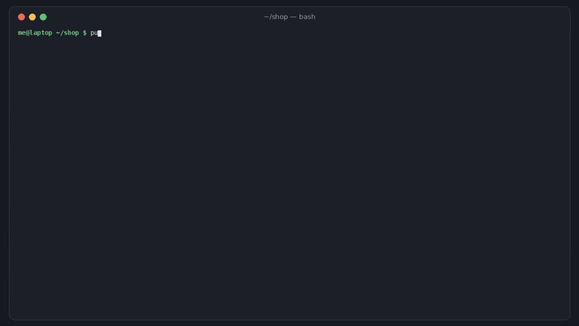

# pullrot

[](https://github.com/hamarshehmhmd/pullrot/actions/workflows/ci.yml)
[](LICENSE)


**Find the container images in your repo that will fail to pull, before your deploy or CI does.**
`pullrot` reads Dockerfiles, compose files, Kubernetes manifests, Helm values, CI configs and devcontainers,
flags removed Bitnami tags, the frozen `k8s.gcr.io`, deprecated official images and anonymous Docker Hub pulls in CI,
checks every tag against its real registry (HEAD requests, no pulls used), and rewrites what can be fixed mechanically.



```bash
pipx install git+https://github.com/hamarshehmhmd/pullrot
```

## Why

Image references rot without a single commit on your side:

- **Bitnami, August 28 2025.** Bitnami moved its free catalog to `docker.io/bitnamilegacy` (frozen, no updates) and
  removed the versioned tags from `docker.io/bitnami`, keeping only a small hardened subset on `:latest`
  ([bitnami/charts#35164](https://github.com/bitnami/charts/issues/35164)). Compose files, Helm values and Dockerfiles
  that said `bitnami/postgresql:16.3.0-debian-12-r14` stopped pulling. The fallout:
  [bitnami/charts#36097](https://github.com/bitnami/charts/issues/36097) *"Why do you plan to break your potential
  customers infrastructure on the 28th?"* (56 comments), [#36309 *"My website went down"*](https://github.com/bitnami/charts/issues/36309),
  [vmware-tanzu/helm-charts#698](https://github.com/vmware-tanzu/helm-charts/issues/698) (Velero's kubectl image, 63 comments),
  [langfuse/langfuse-k8s#206](https://github.com/langfuse/langfuse-k8s/issues/206),
  [acryldata/datahub-helm#596](https://github.com/acryldata/datahub-helm/issues/596), and plenty of people asking for
  [a way to alert on missing images](https://github.com/jetstack/version-checker/issues/395).
  Today `docker.io/bitnami/redis` has exactly one tag: `latest`.
- **Docker Hub pull limits.** Anonymous pulls are rate-limited per IP, and CI runners share IPs, so `services:` and
  `container:` images fail with `toomanyrequests` ([e.g.](https://github.com/Samsung/TICO/issues/72),
  [e.g.](https://github.com/agent-substrate/substrate/issues/2471)).
- **Frozen registries and deprecated images.** `k8s.gcr.io` has had no new images since April 2023 and only redirects
  to `registry.k8s.io`. `openjdk`, `centos`, `jenkins` and friends are deprecated on Docker Hub, and old tags vanish
  (`openjdk:17-jdk-slim` no longer exists).

You normally find out from `ImagePullBackOff` or a red pipeline. `pullrot` finds them in seconds, with file and line.

## Usage

```console
$ pullrot scan --online            # whole repo; exit 1 on errors
$ pullrot scan deploy/ --format github --min-severity warn
$ pullrot fix                      # dry run: unified diff
$ pullrot fix --verify --write     # apply, only to replacements that exist
$ pullrot fix --mirror ecr --write # also move anonymous Docker Hub pulls in CI to ECR Public
$ pullrot check bitnami/redis:7.2.5 bitnamilegacy/redis:7.2.5
$ pullrot ratelimit                # Docker Hub pulls left for this IP (doesn't use one)
$ pullrot list --format json       # every image reference found
```

Example (`examples/shop`, real registries):

```console
$ pullrot scan --online --min-severity error
docker-compose.yml
     5  ERROR PR101  bitnami/postgresql:16.3.0-debian-12-r14
        versioned tags were removed from docker.io/bitnami when Bitnami moved its free catalog to bitnamilegacy
        (2025-08-28). Stopgap: bitnamilegacy (frozen, no security fixes); real fix: the upstream image.
        Confirmed by the registry: repository exists but tag '16.3.0-debian-12-r14' does not.
        -> bitnamilegacy/postgresql:16.3.0-debian-12-r14
...
17 image references in 6 files: 6 errors, 0 warnings, 0 notes
```

### Where it looks

| File | What |
|---|---|
| `Dockerfile*`, `*.dockerfile`, `Containerfile` | `FROM` (with `ARG` defaults and `${VAR:-x}`, stage names skipped), `COPY --from=image` |
| `docker-compose*.yml`, `compose*.yaml` | `image:` |
| Kubernetes YAML | `image:` in any manifest |
| Helm `values.yaml` | `image:` blocks with `registry` / `repository` / `tag` / `digest` keys |
| `.github/workflows/*`, Gitea/Forgejo | `container:`, `services.*.image`, `uses: docker://...` |
| `.gitlab-ci.yml` | `image:` string or `image: {name:}` |
| `.devcontainer/*.json` | `"image"` |

Templated values (`{{ .Values.x }}`, `${{ matrix.image }}`, unresolved `$VAR`) are skipped rather than guessed.
`node_modules`, `vendor`, `.git` and virtualenvs are skipped.

### Rules

| Rule | Severity | What |
|---|---|---|
| PR101 | error / warn | `docker.io/bitnami/*`: versioned tag (removed) / `:latest` (limited, may change). Fix: `bitnamilegacy/*` as a stopgap |
| PR102 | info | `bitnamilegacy/*`: frozen archive, no security fixes |
| PR201 | warn | `k8s.gcr.io/*`. Fix: `registry.k8s.io/*` |
| PR301 | warn | Docker Hub image pulled anonymously in CI (no `docker/login-action` / `docker login` in that file). Fix (opt-in): `public.ecr.aws/docker/library/*` or `mirror.gcr.io/library/*` for official images |
| PR401 | info | no tag / `:latest` and no digest |
| PR402 | warn | deprecated Docker official image (`openjdk`, `java`, `centos`, `jenkins`, `django`, `rails`, `iojs`, `sentry`, `owncloud`, `celery`) with the replacement Docker points to |
| PR501 | error / warn | `--online`: tag/digest or repository not found (or private). Warn instead of error when the reference has no tag (the tag is often a separate `version:` key) or is a non-existent `docker.io/library/*` name (placeholders like kubebuilder's `controller:latest`) |
| PR502 / PR503 | warn / info | `--online`: registry rate-limited us / couldn't reach it |

With `--online`, a missing tag on a PR101/PR201/PR402 reference upgrades that finding to an error marked
*Confirmed by the registry* instead of adding a second one.

### Online checks

`--online`, `check` and `fix --verify` send `HEAD /v2/<repo>/manifests/<tag>` with the standard anonymous bearer-token
flow, so they work with Docker Hub, GHCR, Quay, registry.k8s.io, gcr.io / Artifact Registry, ECR Public, MCR and any
OCI registry. Docker documents that manifest `HEAD` requests don't count toward the pull limit. Set
`DOCKERHUB_USERNAME` and `DOCKERHUB_TOKEN` to check private Docker Hub repos and to see your authenticated limit.
Each unique reference is checked once, 8 at a time.

### Fixing

`pullrot fix` only does rewrites that are mechanical and keep the same image content:
`bitnami/X:tag` -> `bitnamilegacy/X:tag` (same images, moved), `k8s.gcr.io/X` -> `registry.k8s.io/X`, and with
`--mirror`, official Docker Hub images in CI -> ECR Public or Google's mirror. It edits only the reference text, so
comments, quotes and layout stay. In Helm values only the `repository:` line changes. References built from
Dockerfile `ARG`s are reported but not edited. `bitnamilegacy` is a stopgap: it gets no security fixes, so plan the
move to upstream images (`postgres`, `redis`, `registry.k8s.io/kubectl`...). pullrot doesn't pick those for you,
because their configuration (env vars, paths, users) differs.

## GitHub Action

```yaml
# .github/workflows/pullrot.yml
name: pullrot
on:
  pull_request:
  schedule:
    - cron: "17 6 * * 1"   # weekly: tags disappear without a commit
jobs:
  images:
    runs-on: ubuntu-latest
    steps:
      - uses: actions/checkout@v5
      - uses: hamarshehmhmd/pullrot@v0.1.1
        with:
          online: true       # HEAD each image, no pulls used
          fail-on: error     # error | warn | info | never
          # path: deploy/
          # args: --min-severity warn --mirror gcr
```

Findings show up as annotations on the offending lines.

## Demo

[`demo.mp4`](https://github.com/hamarshehmhmd/pullrot/releases/download/v0.1.0/demo.mp4) (2.5 min, narrated) is
attached to the v0.1.0 release. Every terminal scene is real output of `pullrot` on `examples/shop` against the live
registries; `demo/render.py` regenerates it.

## Development

```bash
python -m venv .venv && .venv/bin/pip install -e . pytest
.venv/bin/pytest -q                       # offline: a fake registry with Docker Hub-style token auth
PULLROT_LIVE=1 .venv/bin/pytest -q tests/test_live.py   # against the real registries
```

## License

GNU Affero General Public License v3.0 or later ([LICENSE](LICENSE)), SPDX `AGPL-3.0-or-later`.
Commercial licenses without the AGPL obligations are available from the author, Mohammad Hamarsheh
([@hamarshehmhmd](https://github.com/hamarshehmhmd)); open an issue to get in touch.
